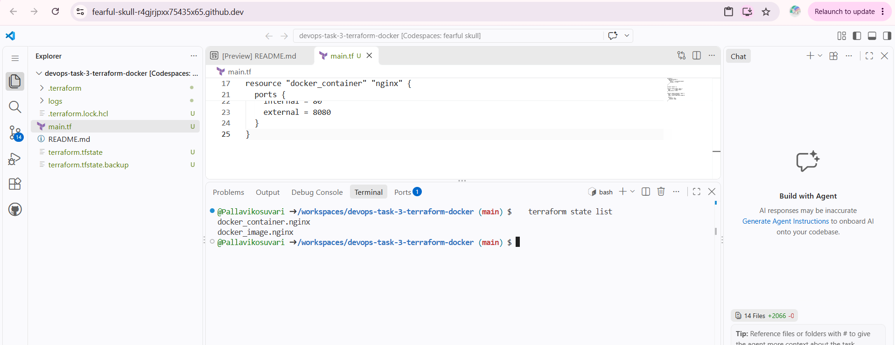
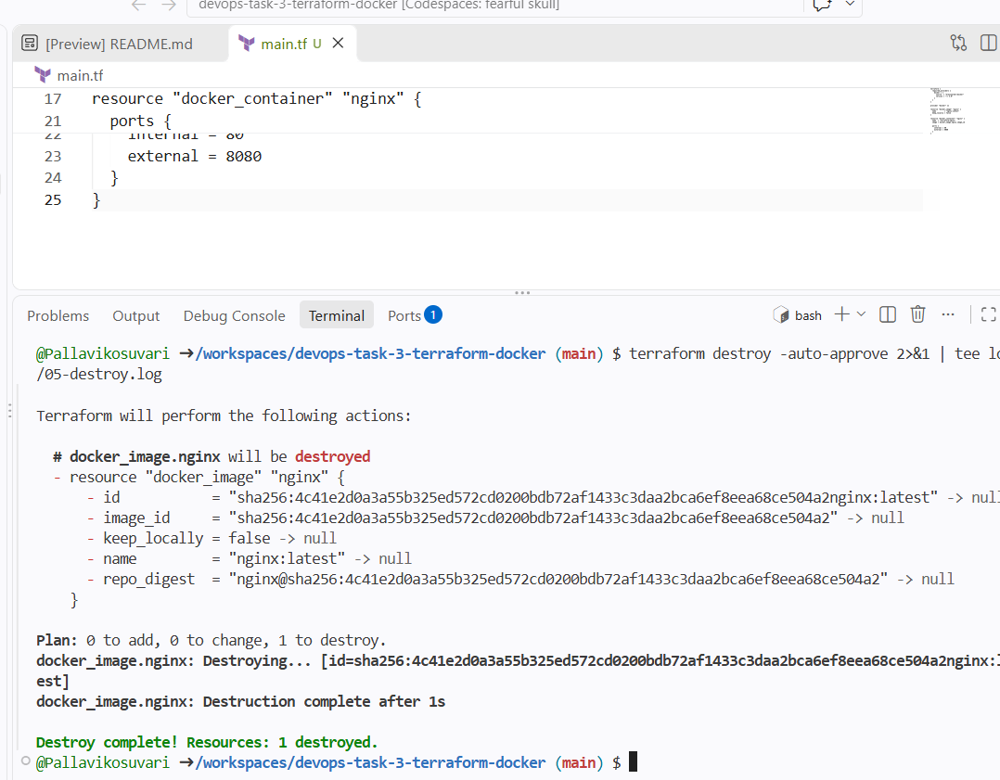

# Terraform: Deploy an Nginx Web Server on AWS

## Overview
This project uses Terraform to provision [an EC2 instance / your resource] and install Nginx automatically, then tears everything down with `terraform destroy`.

## Tools Used
- Terraform
- AWS ([EC2, security group, etc.])
- Nginx
- GitHub Codespaces

## Workflow
1. `terraform init`: initialise providers
2. `terraform plan`: preview resources
3. `terraform apply`: create infrastructure
4. Verify Nginx in the browser
5. `terraform destroy`: clean up all resources

## Screenshots

### Nginx running in the browser

### Terraform state

### Terraform destroy

## Key Learnings
- Infrastructure as Code basics and the Terraform lifecycle
- Why state files and `.terraform/` are excluded via `.gitignore`
- Destroying resources to avoid unnecessary cloud costs